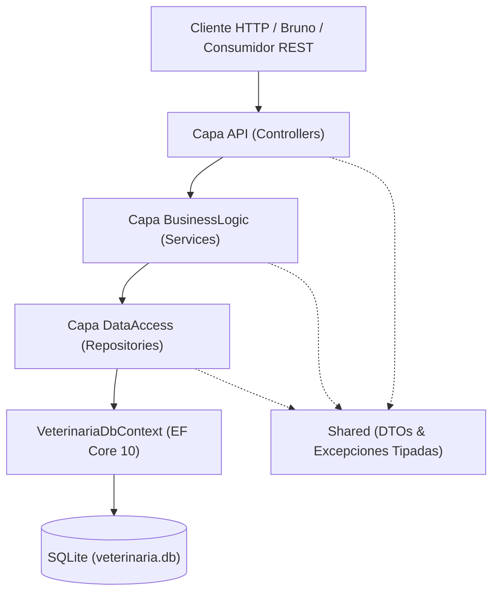

# Sistema de Gestión de Clínica Veterinaria ("Patitas") — API RESTful .NET 10

API RESTful desarrollada desde cero bajo arquitectura en capas (**N-Tier**) en **.NET 10**, implementando persistencia con **Entity Framework Core 10** y **SQLite**, especificación OpenAPI nativa (`/openapi/v1.json`), validaciones de negocio en servicios sin LINQ-to-entities, DTOs manuales desacoplados, excepciones tipadas y suite completa de pruebas unitarias (xUnit + Moq) y de integración (`WebApplicationFactory`).

---

## Enlaces de Referencia del Proyecto

* [Documento General en Google Docs](https://docs.google.com/document/d/15MJOhHVoA6IvHkjPi3N6tqI6hPOxtDK1-A6_SnPE8J8/edit?tab=t.0)
* [Diagrama de Arquitectura en Excalidraw](https://excalidraw.com/#json=LGOu8FaIBGP1mWAqq2GDl,4XjMZUIbbWtyVVLBS2Zz2Q)
* [Casos de Uso en Google Docs](https://docs.google.com/document/d/1q-qFSrRfLvsTYiwFzZFR0_yBjUnrcppa7UAtrz2hwFY/edit?usp=sharing)
* [Informe de Inconsistencias y Decisiones](file:///c:/Users/jazvi/OneDrive/Documentos/GitHub/Grupo_7_SistemaVeterinaria/INFORME-INCONSISTENCIAS-DOCUMENTACION-CASOS-DE-USO.md)
* [Seguimiento de Correcciones y Trazabilidad](file:///c:/Users/jazvi/OneDrive/Documentos/GitHub/Grupo_7_SistemaVeterinaria/SEGUIMIENTO_CORRECCIONES.md)

---

## 1. Arquitectura N-Tier y Flujo de Datos

El sistema implementa estrictamente el flujo unidireccional desacoplado:

$$\text{Controller (API)} \longrightarrow \text{Service (BusinessLogic)} \longrightarrow \text{Repository (DataAccess)} \longrightarrow \text{DbContext (EF Core)}$$



### Árbol de Directorios del Proyecto
```text
Grupo_7_SistemaVeterinaria/
├── API/                                 # Capa de Presentación / Controladores HTTP
│   ├── Controllers/
│   │   ├── AuthController.cs            # Login, cambio de contraseña temporal y logout
│   │   ├── DuenosController.cs          # Endpoints CRUD para Dueños
│   │   ├── MascotasController.cs        # Endpoints, baja lógica y reasignación de Dueño
│   │   ├── AtencionesMedicasController.cs # Endpoints clínicos inmutables (Veterinario)
│   │   ├── HistoriaClinicaController.cs # Consultas de historia clínica canónica y búsqueda
│   │   ├── TurnosController.cs          # Agenda, disponibilidad profesional, reprogramación y cancelación
│   │   ├── UsuariosController.cs        # Gestión administrativa de cuentas, desbloqueo y reseteo
│   │   └── ReportesController.cs        # Generación e historial de reportes modulares
│   ├── Program.cs                       # Configuración de DI, OpenAPI, JWT, Middleware y DbInitializer
│   ├── appsettings.json                 # ConnectionStrings para SQLite
│   ├── appsettings.Development.json     # Clave JWT y configuración para desarrollo local
│   └── API.csproj
├── BusinessLogic/                       # Capa de Lógica de Negocio Pura
│   ├── Interfaces/
│   │   ├── IAuthService.cs
│   │   ├── IDuenoService.cs
│   │   ├── IMascotaService.cs
│   │   ├── IAtencionMedicaService.cs
│   │   ├── IHistoriaClinicaService.cs
│   │   ├── ITurnoService.cs
│   │   ├── IUsuarioService.cs
│   │   └── IReporteService.cs
│   ├── Services/
│   │   ├── AuthService.cs               # Autenticación, control de intentos fallidos y tokens revocados
│   │   ├── DuenoService.cs              # Reglas RN-05, validaciones de DNI, teléfono y email
│   │   ├── MascotaService.cs            # Reglas RN-06, RN-07, MEJ-03 y reasignación
│   │   ├── AtencionMedicaService.cs     # Reglas RN-01, RN-03, RN-04, RN-07, RN-11, RN-12 y fecha última visita
│   │   ├── HistoriaClinicaService.cs    # Consolidación de registros médicos
│   │   ├── TurnoService.cs              # Reglas RN-08, RN-09, RN-10, validación de bloques de 30 min y estados
│   │   ├── UsuarioService.cs            # Desbloqueo y generación de contraseña temporal
│   │   └── ReporteService.cs            # Métricas, agregación y exportación de reportes
│   └── BusinessLogic.csproj
├── DataAccess/                          # Capa de Persistencia y Repositorios
│   ├── Context/
│   │   ├── VeterinariaDbContext.cs      # Fluent API, DeleteBehavior.Restrict, índices únicos
│   │   └── VeterinariaDbContextFactory.cs # Migraciones CLI en tiempo de diseño
│   ├── Entities/                        # Modelos de base de datos relacional
│   ├── Repositories/                    # Implementación de consultas y comandos con AsNoTracking()
│   ├── Migrations/                      # Migraciones generadas por EF Core
│   ├── Seeding/
│   │   └── DbInitializer.cs             # Creación de base y carga automática de datos semilla de prueba
│   └── DataAccess.csproj
├── Shared/                              # Capa Transversal Compartida
│   ├── DTOs/                            # DTOs de entrada y salida organizados por entidad
│   ├── Exceptions/                      # Jerarquía de excepciones tipadas (400, 401, 403, 404, 409)
│   └── Shared.csproj
├── tests/
│   ├── BusinessLogic.Tests/             # 314 Tests Unitarios (xUnit + Moq)
│   └── API.Tests/                       # 225 Tests de Integración (WebApplicationFactory + SQLite en memoria)
├── bruno/                               # Colección completa de requests HTTP para Bruno con scripts dinámicos
├── SistemaVeterinaria.slnx              # Solución .NET 10
├── README.md                            # Documentación general de ejecución y entrega
├── SEGUIMIENTO_CORRECCIONES.md          # Matriz de trazabilidad técnica (38 hallazgos)
└── AGENTS.md                            # Contexto operativo para agentes de IA
```

---

## 2. Instrucciones de Ejecución

### Prerrequisitos
* [.NET 10 SDK](https://dotnet.microsoft.com/download/dotnet/10.0) instalado (`dotnet --version` $\ge$ 10.0.x).

### 2.1. Compilar la Solución
```bash
dotnet build SistemaVeterinaria.slnx
```

### 2.2. Ejecutar la API
```bash
dotnet run --project API/API.csproj
```

La API se expondrá en los puertos configurados en `API/Properties/launchSettings.json`:
* **HTTP:** `http://localhost:5274`
* **HTTPS:** `https://localhost:7207`

Al iniciar, `DbInitializer` crea automáticamente la base de datos SQLite `veterinaria.db` en el directorio de ejecución (si no existe), aplica las migraciones pendientes y precarga datos iniciales de prueba (usuarios con roles, dueños y pacientes clínicos).

> [!WARNING]
> **Advertencia de Seguridad — Configuración de Clave JWT (`JwtSettings:SecretKey`):**
> * El archivo base [`API/appsettings.json`](file:///c:/Users/jazvi/OneDrive/Documentos/GitHub/Grupo_7_SistemaVeterinaria/API/appsettings.json) no contiene claves secretas activas (`"SecretKey": ""`).
> * El archivo [`API/appsettings.Development.json`](file:///c:/Users/jazvi/OneDrive/Documentos/GitHub/Grupo_7_SistemaVeterinaria/API/appsettings.Development.json) incluye una clave exclusiva para desarrollo local con el único propósito de permitir la ejecución académica inmediata mediante `dotnet run --project API/API.csproj`. **Nunca debe utilizarse ni reutilizarse en entornos de producción.**
> * En entornos productivos, la aplicación exige obligatoriamente configurar una clave secreta externa de al menos **32 bytes UTF-8 (256 bits)** (e.g. mediante la variable de entorno `JwtSettings__SecretKey`); si la clave está ausente o es inválida, la aplicación rechaza iniciar por seguridad (SEC-05).

### 2.3. Acceso a la Documentación OpenAPI
En entorno `Development`, la API expone su especificación OpenAPI nativa generada por Microsoft OpenAPI en:
* **JSON de especificación:** `https://localhost:7207/openapi/v1.json` *(o `http://localhost:5274/openapi/v1.json`)*.

### 2.4. Ejecutar la Suite Completa de Tests
```bash
dotnet test SistemaVeterinaria.slnx
```
La solución cuenta con un total de **539 pruebas automatizadas** que se ejecutan sin dependencias externas:
* **314 pruebas unitarias:** En `tests/BusinessLogic.Tests/BusinessLogic.Tests.csproj` (xUnit + Moq), validando exhaustivamente todas las reglas clínicas y de agenda.
* **225 pruebas de integración:** En `tests/API.Tests/API.Tests.csproj` (`WebApplicationFactory` y SQLite en memoria), cubriendo flujos HTTP completos, autenticación, autorización por roles y códigos de respuesta.

---

## 3. Usuarios de Demostración y Credenciales de Desarrollo

Para fines exclusivamente académicos y de verificación local, `DbInitializer` siembra los siguientes usuarios con contraseñas seguras preconfiguradas:

| Usuario | Correo Electrónico | Contraseña de Prueba | Rol Asignado | Estado Inicial | Propósito en Demostración |
|---|---|---|---|:---:|---|
| `admin` | `admin@patitas.com` | `Admin1234!` | **Administrador** | Activo | Gestión de usuarios, desbloqueos, reseteos y generación de reportes. |
| `vet.carlos` | `carlos.veterinario@patitas.com` | `Vet1234!` | **Veterinario** | Activo | Consultas e ingresos clínicos, historias clínicas y configuración de disponibilidad horaria. |
| `recep.ana` | `ana.recepcion@patitas.com` | `Recep1234!` | **Recepcionista** | Activo | Registro y actualización de dueños, alta y baja lógica de mascotas, y asignación de turnos. |
| `user.bloqueado` | `bloqueado@patitas.com` | `User1234!` | **Recepcionista** | Bloqueado (5 intentos) | Demostración del endpoint de desbloqueo administrativo (`POST /api/usuarios/{id}/desbloquear`). |
| `user.inactivo` | `inactivo@patitas.com` | `User1234!` | **Veterinario** | Inactivo | Validación de rechazo ante operaciones sobre cuentas inactivas. |
| `user.temporal` | `temporal@patitas.com` | `Temporal1234!` | **Recepcionista** | Requiere cambio | Demostración de cambio de contraseña temporal (`POST /api/auth/cambiar-password-temporal`). |

---

## 4. Reglas de Negocio Implementadas

| Identificador | Regla de Negocio | Código HTTP | Implementación |
|---|---|:---:|---|
| **RN-01** | Inmutabilidad de las Atenciones Médicas | **409 Conflict** | Las atenciones médicas registradas son inmutables. Métodos `PUT` y `DELETE` arrojan `AtencionInmutableException`. |
| **RN-03 / RN-04** | Vacunación Condicionada a Aptitud Clínica | **409 Conflict** | Si se envía `VacunaAplicada` pero `EsAptoVacunacion` es `false`, se rechaza con `PacienteNoAptoVacunacionException`. |
| **RN-05** | Unicidad del DNI del Dueño | **409 Conflict** | No se permite registrar ni actualizar dueños con DNIs ya existentes (`DniDuplicadoException` e índice único). |
| **RN-06** | Asociación Obligatoria de Mascota a Dueño | **404 Not Found** | Toda mascota requiere un `DuenoId` válido y existente (`DuenoNotFoundException`). |
| **RN-07 / MEJ-03** | Baja Lógica y Preservación Histórica | **200 OK / 409 Conflict** | La baja de una mascota es lógica (`Activa = false`). Si la mascota ya estaba inactiva, se rechaza con **409 Conflict** (`MascotaYaInactivaException`). Si estaba activa, devuelve **200 OK**. |
| **RN-07 (Clínica)** | Restricción de Atención en Inactivas | **409 Conflict** | Una mascota inactiva no puede recibir nuevas atenciones médicas ni turnos (`MascotaInactivaException`). |
| **RN-08** | No Superposición de Turnos | **409 Conflict** | No se pueden agendar turnos superpuestos para un mismo veterinario (`HorarioNoDisponibleException`). La cancelación libera el horario de inmediato. |
| **RN-09** | Protección de Turno Finalizado o Cancelado | **409 Conflict** | Un turno en estado `Finalizado` o `Cancelado` no puede ser reprogramado ni cancelado nuevamente (`TurnoFinalizadoException`, `TurnoYaCanceladoException`). |
| **RN-10** | Disponibilidad Horaria Profesional | **409 Conflict** | Los turnos solo pueden agendarse dentro de las franjas semanales activas configuradas por el veterinario (`HorarioNoDisponibleException`). |
| **RN-11 / BUG-06** | Coherencia en Seguimiento Crónico | **400 Bad Request** | Si `EsEnfermedadCronica` es `true`, debe enviarse el bloque de `SeguimientoCronico`; si es `false`, dicho bloque no debe remitirse. |
| **RN-12** | Alerta Automática de Pérdida de Peso | **201 Created** | Si el peso disminuye $\ge$ 15% respecto a la consulta anterior, se emite una alerta médica dentro de `mensajeAlertaDesnutricion`. |
| **Bloques de 30 min** | Alineación Horaria Obligatoria | **400 Bad Request** | Los turnos y las franjas de disponibilidad deben estar alineados a bloques exactos de 30 minutos (`:00` o `:30`). |
| **DeleteBehavior.Restrict** | Protección de Integridad Referencial | **409 Conflict** | No se permite eliminar un dueño si tiene mascotas asociadas (`DuenoConMascotasException`). |
| **Fecha Última Visita** | Actualización Automática | **201 Created** | Al registrar con éxito una atención médica, se actualiza automáticamente la fecha de última visita de la mascota. |

---

## 5. Respuestas de Error Estandarizadas

Las respuestas de error en la API devuelven mensajes claros y específicos orientados al usuario final, **sin exponer identificadores internos GUID, detalles de base de datos ni códigos de regla internos** (ERR-02):

```json
{
  "message": "El documento ingresado ya se encuentra registrado para otro cliente."
}
```

```json
{
  "message": "La atención médica es inmutable y no puede ser modificada ni eliminada."
}
```

---

## 6. Colección de Bruno (`bruno/`)

La carpeta `bruno/` contiene la colección estructurada de solicitudes HTTP para [Bruno Client](https://www.usebruno.com/).

### 6.1. Variables de Entorno (`Local.bru`)
El archivo de entorno [`bruno/environments/Local.bru`](file:///c:/Users/jazvi/OneDrive/Documentos/GitHub/Grupo_7_SistemaVeterinaria/bruno/environments/Local.bru) contiene la URL base (`{{baseUrl}} = http://localhost:5274` o `https://localhost:7207`) y variables vacías que se completan automáticamente durante la ejecución mediante scripts dinámicos:
* **Tokens de acceso:** `{{tokenAdministrador}}`, `{{tokenVeterinario}}`, `{{tokenRecepcionista}}`.
* **Identificadores dinámicos:** `{{veterinarioId}}`, `{{duenoId}}`, `{{mascotaId}}`, `{{turnoId}}`, etc.

### 6.2. Orden de Preparación y Ejecución Recomendado
Para ejecutar la colección completa sin dependencias rotas, se debe respetar el siguiente orden de carpetas:

1. **`auth/` (Autenticación):**
   * Ejecutar `auth/1`, `auth/2` y `auth/3` para iniciar sesión y capturar dinámicamente los tokens de cada rol y el `{{veterinarioId}}` (extraído del token JWT).
2. **`duenos/` (Clientes):**
   * Ejecutar `duenos/1` para listar y almacenar `{{duenoId}}` y `{{segundoDuenoId}}`.
   * Ejecutar `duenos/2` (genera automáticamente un DNI aleatorio en pre-request evitando colisiones).
3. **`mascotas/` (Pacientes):**
   * Ejecutar `mascotas/1` para capturar `{{mascotaId}}`, `{{mascotaDuenoId}}`, `{{mascotaSinAtencionesId}}` y `{{mascotaInactivaId}}`.
   * Ejecutar las pruebas de creación, baja lógica y reasignación de dueño.
4. **`turnos/` (Agenda y Disponibilidad):**
   * **Paso previo obligatorio:** Ejecutar `turnos/0. Preparar - Configurar Disponibilidad Semanal (200 OK)` para establecer el horario laboral del veterinario antes de solicitar turnos (RN-10).
   * Ejecutar `turnos/3` para agendar un turno válido a futuro (calculado automáticamente en el pre-request) y guardar `{{turnoId}}`.
   * Ejecutar las pruebas de superposición horaria (`turnos/8`), reprogramación (`turnos/9`) y cancelación (`turnos/11`).
5. **`atenciones-medicas/` e `historia-clinica/` (Atención Clínica):**
   * Ejecutar `atenciones-medicas/0` para registrar la mascota de control de peso y almacenar `{{mascotaAlertaId}}`.
   * Ejecutar el registro de atenciones incluyendo obligatoriamente `anamnesis` y `examenFisico` (BUG-03).
   * Probar la detección automática de pérdida de peso en `atenciones-medicas/10`.
6. **`usuarios/` y `reportes/` (Administración):**
   * Ejecutar con `{{tokenAdministrador}}` para auditoría de usuarios y generación de reportes con rangos de fechas válidos.

> [!NOTE]
> **Limitación de Escenario para Turno Finalizado (`turnos/10`):**
> La solicitud `turnos/10. Reprogramar Turno - Turno Finalizado (409 Conflict - RN-09)` requiere que el turno se encuentre en estado `Finalizado`. En el modelo de negocio, un turno solo adquiere dicho estado cuando se completa una atención médica asociada; la API no provee un endpoint manual para forzar el estado a `Finalizado`. Si se ejecuta sin configurar manualmente un turno previamente atendido en la variable `{{turnoFinalizadoId}}`, el endpoint devolverá `404 Not Found`.
