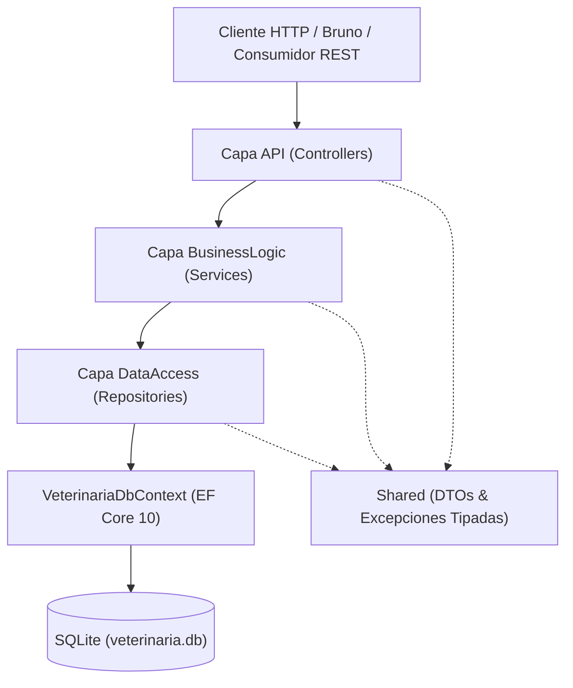

# Sistema de Gestión de Clínica Veterinaria ("Patitas") — API RESTful .NET 10

API RESTful desarrollada desde cero bajo arquitectura en capas (**N-Tier**) en **.NET 10**, implementando persistencia con **Entity Framework Core 10** y **SQLite**, especificación OpenAPI nativa (`/openapi/v1.json`), validaciones de negocio en servicios sin LINQ-to-entities, DTOs manuales desacoplados, excepciones tipadas y suite completa de pruebas unitarias (xUnit + Moq) y de integración (`WebApplicationFactory`).

---

## Enlaces de Referencia del Proyecto

* [Documento General en Google Docs](https://docs.google.com/document/d/15MJOhHVoA6IvHkjPi3N6tqI6hPOxtDK1-A6_SnPE8J8/edit?tab=t.0)
* [Diagrama de Arquitectura en Excalidraw](https://excalidraw.com/#json=LGOu8FaIBGP1mWAqq2GDl,4XjMZUIbbWtyVVLBS2Zz2Q)
* [Casos de Uso en Google Docs](https://docs.google.com/document/d/1q-qFSrRfLvsTYiwFzZFR0_yBjUnrcppa7UAtrz2hwFY/edit?usp=sharing)
*[Presentación de Patitas](https://canva.link/9wkud9qc5zncgb0)
* [Informe de Inconsistencias y Decisiones](file:///c:/Users/jazvi/OneDrive/Documentos/GitHub/Grupo_7_SistemaVeterinaria/INFORME-INCONSISTENCIAS-DOCUMENTACION-CASOS-DE-USO.md)
* [Seguimiento de Correcciones y Trazabilidad](file:///c:/Users/jazvi/OneDrive/Documentos/GitHub/Grupo_7_SistemaVeterinaria/SEGUIMIENTO_CORRECCIONES.md)

---

## 1. Arquitectura N-Tier y Flujo de Datos

El sistema implementa estrictamente el flujo unidireccional desacoplado:

$$\text{Controller (API)} \longrightarrow \text{Service (BusinessLogic)} \longrightarrow \text{Repository (DataAccess)} \longrightarrow \text{DbContext (EF Core)}$$



### Árbol de Directorios del Proyecto
```text
Grupo_7_SistemaVeterinaria/
├── API/                                 # Capa de Presentación / Controladores HTTP
│   ├── Controllers/
│   │   ├── AuthController.cs            # Login, cambio de contraseña temporal y logout
│   │   ├── DuenosController.cs          # Endpoints CRUD para Dueños
│   │   ├── MascotasController.cs        # Endpoints, baja lógica y reasignación de Dueño
│   │   ├── AtencionesMedicasController.cs # Endpoints clínicos inmutables (Veterinario)
│   │   ├── HistoriaClinicaController.cs # Consultas de historia clínica canónica y búsqueda
│   │   ├── TurnosController.cs          # Agenda, disponibilidad profesional, reprogramación y cancelación
│   │   ├── UsuariosController.cs        # Gestión administrativa de cuentas, desbloqueo y reseteo
│   │   └── ReportesController.cs        # Generación e historial de reportes modulares
│   ├── Program.cs                       # Configuración de DI, OpenAPI, JWT, Middleware y DbInitializer
│   ├── appsettings.json                 # ConnectionStrings, JWT (sin clave) y RateLimiting
│   ├── appsettings.Development.json     # Configuración no sensible para desarrollo local (sin secretos)
│   └── API.csproj                       # Proyecto Web con soporte habilitado para .NET User Secrets
├── BusinessLogic/                       # Capa de Lógica de Negocio Pura
│   ├── Interfaces/
│   │   ├── IAuthService.cs
│   │   ├── IDuenoService.cs
│   │   ├── IMascotaService.cs
│   │   ├── IAtencionMedicaService.cs
│   │   ├── IHistoriaClinicaService.cs
│   │   ├── ITurnoService.cs
│   │   ├── IUsuarioService.cs
│   │   └── IReporteService.cs
│   ├── Services/
│   │   ├── AuthService.cs               # Autenticación, control de intentos fallidos y tokens revocados
│   │   ├── DuenoService.cs              # Reglas RN-05, validaciones de DNI, teléfono y email
│   │   ├── MascotaService.cs            # Reglas RN-06, RN-07, MEJ-03 y reasignación
│   │   ├── AtencionMedicaService.cs     # Reglas RN-01, RN-03, RN-04, RN-07, RN-11, RN-12 y fecha última visita
│   │   ├── HistoriaClinicaService.cs    # Consolidación de registros médicos
│   │   ├── TurnoService.cs              # Reglas RN-08, RN-09, RN-10, bloques de 30 min, estados y autorización por recurso
│   │   ├── VeterinarioLockManager.cs    # Bloqueo en memoria por veterinario/turno para operaciones críticas de agenda
│   │   ├── UsuarioService.cs            # Desbloqueo y generación de contraseña temporal
│   │   └── ReporteService.cs            # Métricas, agregación y exportación de reportes
│   └── BusinessLogic.csproj
├── DataAccess/                          # Capa de Persistencia y Repositorios
│   ├── Context/
│   │   ├── VeterinariaDbContext.cs      # Fluent API, DeleteBehavior.Restrict, índices únicos
│   │   └── VeterinariaDbContextFactory.cs # Migraciones CLI en tiempo de diseño
│   ├── Entities/                        # Modelos de base de datos relacional
│   ├── Repositories/                    # Implementación de consultas y comandos con AsNoTracking()
│   ├── Migrations/                      # 11 migraciones de EF Core (la última: AddFechaRegistroMascota)
│   ├── Seeding/
│   │   └── DbInitializer.cs             # Creación de base y carga automática de datos semilla de prueba
│   └── DataAccess.csproj
├── Shared/                              # Capa Transversal Compartida
│   ├── DTOs/                            # DTOs de entrada y salida organizados por entidad
│   ├── Exceptions/                      # Jerarquía de excepciones tipadas (400, 401, 403, 404, 409)
│   └── Shared.csproj
├── tests/
│   ├── BusinessLogic.Tests/             # 400 Tests Unitarios (xUnit + Moq)
│   └── API.Tests/                       # 287 Tests de Integración (WebApplicationFactory + SQLite en memoria)
├── bruno/                               # Colección completa de requests HTTP para Bruno con scripts dinámicos
├── SistemaVeterinaria.slnx              # Solución .NET 10
├── README.md                            # Documentación general de ejecución y entrega
├── SEGUIMIENTO_CORRECCIONES.md          # Matriz de trazabilidad técnica (38 hallazgos) y recomendaciones de auditoría 1 a 9
└── AGENTS.md                            # Contexto operativo para agentes de IA
```

---

## 2. Instrucciones de Ejecución

### Prerrequisitos
* [.NET 10 SDK](https://dotnet.microsoft.com/download/dotnet/10.0) instalado (`dotnet --version` $\ge$ 10.0.x).

### 2.1. Compilar la Solución
```bash
dotnet build SistemaVeterinaria.slnx
```

### 2.2. Configurar la Clave Secreta JWT (Obligatorio antes de ejecutar)

Por seguridad, el repositorio **no incluye ninguna clave secreta versionada** en [`API/appsettings.json`](file:///c:/Users/jazvi/OneDrive/Documentos/GitHub/Grupo_7_SistemaVeterinaria/API/appsettings.json) ni en [`API/appsettings.Development.json`](file:///c:/Users/jazvi/OneDrive/Documentos/GitHub/Grupo_7_SistemaVeterinaria/API/appsettings.Development.json). La aplicación exige una clave secreta (`JwtSettings:SecretKey`) de al menos **32 bytes UTF-8 (256 bits)**; si no está configurada o es más corta, rechaza iniciar (`InvalidOperationException`).

Antes de iniciar la API localmente, configurá tu propia clave secreta eligiendo **una** de las siguientes opciones (reemplazando `<TU_CLAVE_SECRETA_DE_AL_MENOS_32_CARACTERES>` por un valor propio de 32 o más caracteres):

* **Opción A — .NET User Secrets (recomendado para desarrollo local, se ejecuta una sola vez por integrante y por máquina):** `API/API.csproj` ya define el `UserSecretsId`; el secreto se guarda en tu perfil de usuario, fuera del repositorio.
  ```bash
  dotnet user-secrets set "JwtSettings:SecretKey" "<TU_CLAVE_SECRETA_DE_AL_MENOS_32_CARACTERES>" --project API/API.csproj
  dotnet user-secrets list --project API/API.csproj   # verifica que la clave esté configurada
  ```
* **Opción B — Variable de entorno en la sesión actual de terminal:**
  * **PowerShell (Windows):**
    ```powershell
    $env:JwtSettings__SecretKey = "<TU_CLAVE_SECRETA_DE_AL_MENOS_32_CARACTERES>"
    ```
  * **Bash (Linux / macOS):**
    ```bash
    export JwtSettings__SecretKey="<TU_CLAVE_SECRETA_DE_AL_MENOS_32_CARACTERES>"
    ```

### 2.3. Ejecutar la API
```bash
dotnet run --project API/API.csproj
```

La API se expondrá en los puertos configurados en `API/Properties/launchSettings.json`:
* **HTTP:** `http://localhost:5274`
* **HTTPS:** `https://localhost:7207`

Al iniciar, `DbInitializer` ejecuta `Database.MigrateAsync()`: crea la base SQLite si no existe, aplica las migraciones pendientes y, solo si la base está vacía, precarga datos iniciales de prueba (usuarios con roles, dueños, mascotas y pacientes clínicos). La cadena de conexión (`Data Source=veterinaria.db;Cache=Shared`) es relativa y el archivo resultante es **`API/veterinaria.db`**. Los archivos `*.db`, `*.db-shm` y `*.db-wal` están excluidos de Git.

### 2.4. Acceso a la Documentación OpenAPI
En entorno `Development`, la API expone su especificación OpenAPI nativa (`Microsoft.AspNetCore.OpenApi`, `AddOpenApi()` / `MapOpenApi()`) en:
* **JSON de especificación:** `https://localhost:7207/openapi/v1.json` *(o `http://localhost:5274/openapi/v1.json`)*.

> [!NOTE]
> **Scalar no está implementado:** el proyecto no incluye interfaz gráfica de documentación (ni Scalar ni Swagger UI). La especificación JSON puede importarse en clientes como Bruno, Postman o Insomnia; la colección de `bruno/` cubre todos los endpoints.

### 2.5. Ejecutar la Suite Completa de Tests
```bash
dotnet test SistemaVeterinaria.slnx
```
La solución cuenta con un total de **687 pruebas automatizadas, todas superadas** (última verificación completa, con 0 errores de compilación), que se ejecutan sin dependencias externas ni clave JWT real:
* **400 pruebas unitarias:** En `tests/BusinessLogic.Tests/BusinessLogic.Tests.csproj` (xUnit + Moq), validando exhaustivamente todas las reglas clínicas y de agenda.
* **287 pruebas de integración:** En `tests/API.Tests/API.Tests.csproj` (`WebApplicationFactory` y SQLite en memoria), cubriendo flujos HTTP completos, autenticación, autorización por roles, rate limiting (`429`), concurrencia de agenda, índices únicos (`409`) y reportes por período. El factory de pruebas inyecta su propia clave JWT de prueba y eleva el límite de rate limiting para no interferir.

### 2.6. Configuración de Rate Limiting en Autenticación
`POST /api/auth/login` y `POST /api/auth/cambiar-password-temporal` están protegidos por la política nativa `AuthPolicy` de ASP.NET Core (ventana fija por IP). Al superar el límite responden **`429 Too Many Requests`** con `{ "message": "..." }`. Se configura en `API/appsettings.json`:
```json
"RateLimiting": { "AuthPermitLimit": 10, "AuthWindowSeconds": 60 }
```
Es independiente del bloqueo de cuenta tras **5 intentos fallidos**, que sigue vigente.

### 2.7. Migraciones y Base de Datos SQLite
Las migraciones están en `DataAccess/Migrations/` y se aplican automáticamente al iniciar la API (`MigrateAsync()`). Historial actual (11):

| # | Migración | Contenido |
|:-:|---|---|
| 1 | `InitialCreate` | Dueños, mascotas y atenciones médicas |
| 2 | `AddUsuariosTable` | Usuarios y roles |
| 3 | `AddTokensRevocadosTable` | Revocación de tokens JWT |
| 4 | `AddRegistrosOperacionesUsuariosTable` | Auditoría de operaciones administrativas |
| 5 | `AddHistorialesPropietariosTable` | Historial de reasignación de dueño |
| 6 | `AddTurnosAndDisponibilidadesTables` | Turnos y disponibilidad |
| 7 | `UpdateAtencionMedicaAndAddRelatedTables` | Prescripciones, estudios y procedimientos |
| 8 | `AddReportesTable` | Reportes persistidos |
| 9 | `AddTiemposAtencionTurnoYRelacionAtencionMedica` | Estado `EnAtencion`, tiempos y `AtencionMedica.TurnoId` |
| 10 | `AddUniqueIndexesTurnosYDisponibilidad` | 3 índices únicos de agenda (solo índices) |
| 11 | `AddFechaRegistroMascota` | Columna `Mascotas.FechaRegistro` (`TEXT NULL`, sin modificar filas existentes) |

Comandos y buenas prácticas:
```bash
dotnet ef migrations add <Nombre> --project DataAccess/DataAccess.csproj --startup-project API/API.csproj
dotnet ef database update --project DataAccess/DataAccess.csproj --startup-project API/API.csproj
```
* **Antes de migrar `API/veterinaria.db`, hacé una copia de respaldo** y verificá `PRAGMA integrity_check`.
* Las mascotas históricas (anteriores a la migración 11) conservan `FechaRegistro = NULL`: su fecha de alta es desconocida y **no se contabilizan en reportes de altas por período**.
* Las pruebas de integración usan SQLite en memoria y no tocan `API/veterinaria.db`.

---

### 2.8. Endpoints y Roles

| Controlador / Ruta base | Autorización | Endpoints |
|---|---|---|
| `AuthController` — `/api/auth` | Anónimo con rate limiting (`login`, `cambiar-password-temporal`); autenticado (`logout`, `verificar-sesion`) | `POST login`, `POST cambiar-password-temporal`, `POST logout`, `GET verificar-sesion` |
| `DuenosController` — `/api/duenos` | `Recepcionista`, `Veterinario` | `GET`, `GET {id}`, `POST`, `PUT {id}`, `DELETE {id}` |
| `MascotasController` — `/api/mascotas` | `Recepcionista`, `Veterinario` | `GET`, `GET {id}`, `GET dueno/{duenoId}`, `POST`, `PUT {id}`, `PATCH {id}/desactivar` (o `DELETE {id}`: baja lógica), `PATCH {id}/reasignar-dueno` |
| `AtencionesMedicasController` — `/api/atenciones-medicas` (alias `/api/atenciones`) | `Veterinario` | `GET`, `GET {id}`, `GET mascota/{mascotaId}`, `POST`; `PUT` y `DELETE` siempre `409` (RN-01) |
| `HistoriaClinicaController` — `/api/historias-clinicas` | `Veterinario` | `GET {mascotaId}`, `GET mascota/{mascotaId}`, `GET /api/mascotas/{mascotaId}/historia-clinica`, `GET` (búsqueda) |
| `TurnosController` — `/api/turnos` | `Recepcionista`, `Veterinario`; `iniciar-atencion` y `finalizar` solo `Veterinario` asignado | `GET`, `GET {id}`, `POST`, `PUT {id}`, `POST {id}/confirmar`, `POST {id}/iniciar-atencion`, `POST {id}/finalizar`, `PATCH`/`POST {id}/cancelar`, `GET`/`PUT`/`POST disponibilidad/{veterinarioId}` |
| `UsuariosController` — `/api/usuarios` | `Administrador` | `GET`, `GET {id}`, `POST {id}/desbloquear`, `POST {id}/restablecer-password` |
| `ReportesController` — `/api/reportes` | `Administrador` | `POST` (o `POST generar`), `GET`, `GET {id}` |

El detalle de cada contrato (DTOs y respuestas) está en `/openapi/v1.json` y en la colección de `bruno/`.

---

## 3. Usuarios de Demostración y Credenciales de Desarrollo

Para fines exclusivamente académicos y de verificación local, `DbInitializer` siembra los siguientes usuarios con contraseñas seguras preconfiguradas:

| Usuario | Correo Electrónico | Contraseña de Prueba | Rol Asignado | Estado Inicial | Propósito en Demostración |
|---|---|---|---|:---:|---|
| `admin` | `admin@patitas.com` | `Admin1234!` | **Administrador** | Activo | Gestión de usuarios, desbloqueos, reseteos y generación de reportes. |
| `vet.carlos` | `carlos.veterinario@patitas.com` | `Vet1234!` | **Veterinario** | Activo | Consultas e ingresos clínicos, historias clínicas y configuración de disponibilidad horaria. |
| `recep.ana` | `ana.recepcion@patitas.com` | `Recep1234!` | **Recepcionista** | Activo | Registro y actualización de dueños, alta y baja lógica de mascotas, y asignación de turnos. |
| `user.bloqueado` | `bloqueado@patitas.com` | `User1234!` | **Recepcionista** | Bloqueado (5 intentos) | Demostración del endpoint de desbloqueo administrativo (`POST /api/usuarios/{id}/desbloquear`). |
| `user.inactivo` | `inactivo@patitas.com` | `User1234!` | **Veterinario** | Inactivo | Validación de rechazo ante operaciones sobre cuentas inactivas. |
| `user.temporal` | `temporal@patitas.com` | `Temporal1234!` | **Recepcionista** | Requiere cambio | Demostración de cambio de contraseña temporal (`POST /api/auth/cambiar-password-temporal`). |

---

## 4. Reglas de Negocio Implementadas

| Identificador | Regla de Negocio | Código HTTP | Implementación |
|---|---|:---:|---|
| **RN-01** | Inmutabilidad de las Atenciones Médicas | **409 Conflict** | Las atenciones médicas registradas son inmutables. Métodos `PUT` y `DELETE` arrojan `AtencionInmutableException`. |
| **RN-03 / RN-04** | Vacunación Condicionada a Aptitud Clínica | **409 Conflict** | Si se envía `VacunaAplicada` pero `EsAptoVacunacion` es `false`, se rechaza con `PacienteNoAptoVacunacionException`. |
| **RN-05** | Unicidad del DNI del Dueño | **409 Conflict** | No se permite registrar ni actualizar dueños con DNIs ya existentes (`DniDuplicadoException` e índice único). |
| **RN-06** | Asociación Obligatoria de Mascota a Dueño | **404 Not Found** | Toda mascota requiere un `DuenoId` válido y existente (`DuenoNotFoundException`). |
| **RN-07 / MEJ-03** | Baja Lógica y Preservación Histórica | **200 OK / 409 Conflict** | La baja de una mascota es lógica (`Activa = false`). Si la mascota ya estaba inactiva, se rechaza con **409 Conflict** (`MascotaYaInactivaException`). Si estaba activa, devuelve **200 OK**. |
| **RN-07 (Clínica)** | Restricción de Atención en Inactivas | **409 Conflict** | Una mascota inactiva no puede recibir nuevas atenciones médicas ni turnos (`MascotaInactivaException`). |
| **RN-08** | No Superposición de Turnos | **409 Conflict** | No se pueden agendar turnos superpuestos para un mismo veterinario (`HorarioNoDisponibleException`). Los estados `Confirmado`, `EnAtencion` y `Finalizado` ocupan horario; la cancelación libera el horario de inmediato. |
| **RN-09** | Máquina de Estados `EnAtencion`, Vinculación Clínica y Protección de Turnos | **403 / 409** | Secuencia `Pendiente → Confirmado → EnAtencion → Finalizado` (cancelable desde `Pendiente` o `Confirmado`). Solo el veterinario asignado puede iniciar (`FechaHoraInicioAtencion` UTC) y finalizar (`FechaHoraFinAtencion` UTC) el turno (`403 Forbidden`). Para finalizar se exige una atención médica vinculada (`AtencionMedica.TurnoId`, relación opcional `1:1`, máx. 1 por turno) o se permite registrar atenciones espontáneas (`TurnoId = null`). Un turno en `EnAtencion`, `Finalizado` o `Cancelado` no puede reprogramarse ni cancelarse (`TurnoEnAtencionException`, `TurnoFinalizadoException`, `TurnoYaCanceladoException`). |
| **RN-10** | Disponibilidad Horaria Profesional | **409 Conflict** | Los turnos solo pueden agendarse dentro de las franjas semanales activas configuradas por el veterinario (`HorarioNoDisponibleException`). |
| **RN-11 / BUG-06** | Seguimiento Crónico y Atomicidad Transaccional | **400 / 201** | Si `EsEnfermedadCronica` es `true`, debe enviarse `SeguimientoCronico`; genera la serie de turnos futuros vinculados mediante `Turno.AtencionMedicaId` (`1:N`) dentro de la misma transacción de EF Core. |
| **RN-12** | Alerta Automática de Pérdida de Peso | **201 Created** | Si el peso disminuye $>$ 10% respecto a la consulta anterior (o ficha inicial), se activa `alertaDesnutricion` y se informa `mensajeAlertaDesnutricion`. |
| **Bloques de 30 min** | Alineación Horaria Obligatoria | **400 Bad Request** | Los turnos y las franjas de disponibilidad deben estar alineados a bloques exactos de 30 minutos (`:00` o `:30`). |
| **DeleteBehavior.Restrict** | Protección de Integridad Referencial | **409 Conflict** | No se permite eliminar un dueño si tiene mascotas asociadas (`DuenoConMascotasException`). |
| **Fecha Última Visita** | Actualización Automática | **201 Created** | Al registrar con éxito una atención médica, se actualiza automáticamente la fecha de última visita de la mascota. |
| **Fecha de Registro de Mascota** | Alta inmutable y reporte de altas por período | **200 / 201** | `Mascota.FechaRegistro` (`DateTime?`, UTC) se asigna al registrar y no se modifica en las actualizaciones. El módulo `Mascotas` de los reportes cuenta solo las altas con `FechaRegistro` dentro de `fechaDesde`–`fechaHasta`. **Las mascotas históricas con `FechaRegistro = NULL` (alta desconocida, anteriores a esta columna) no se contabilizan en reportes de altas por período**; sus fechas no se estiman. |
| **Integridad de agenda (índices únicos)** | Sin doble reserva ni duplicados | **409 Conflict** | Índices únicos en SQLite: `IX_Turnos_VeterinarioId_FechaHora` (filtrado a `Confirmado`, `EnAtencion` y `Finalizado`), `IX_DisponibilidadesVeterinarios_VeterinarioId_DiaSemana_Jornada` e `IX_Turnos_AtencionMedicaId_FechaHora` (excluye cancelados y nulos). Se complementan con `VeterinarioLockManager` y transacciones; el reemplazo de disponibilidad es atómico. Las violaciones de unicidad se traducen a excepciones de dominio (`HorarioNoDisponibleException`, `DisponibilidadInvalidaException`, `SeguimientoCronicoDuplicadoException`). |
| **Autorización por recurso en turnos** | Veterinario solo opera sus turnos | **403 Forbidden** | Un `Veterinario` no puede modificar, confirmar ni cancelar turnos de otro profesional ni reasignarlos (`TurnoVeterinarioNoAutorizadoException`). `Recepcionista` gestiona cualquier turno. |
| **Rate limiting de autenticación** | Límite de solicitudes por IP | **429 Too Many Requests** | Política `AuthPolicy` en login y cambio de contraseña temporal, configurable en `RateLimiting`. Compatible con el bloqueo de cuenta tras 5 intentos fallidos. |
| **Secreto JWT externalizado** | Clave fuera del repositorio | — | `JwtSettings:SecretKey` (mínimo 32 bytes UTF-8) se obtiene de User Secrets o variable de entorno; si falta, la API no inicia. |

---

## 4.1. Estado de las Recomendaciones de la Auditoría

| # | Recomendación | Estado |
|:-:|---|---|
| 1 | Máquina de estados de turno con `EnAtencion` | Implementada |
| 2 | Atomicidad de atención médica y seguimiento crónico | Implementada |
| 3 | Historia clínica como proyección lógica derivada (documentada) | Implementada |
| 4 | `FechaRegistro` de mascotas y métricas por período | Implementada |
| 5 | Integridad de agenda: bloqueos, transacciones e índices únicos | Implementada |
| 6 | Autorización horizontal en turnos | Implementada |
| 7 | Secreto JWT externalizado y rate limiting | Implementada |
| 8 | Refactorización de servicios extensos y estados tipados | **Pendiente** |
| 9 | Actualización de README y AGENTS.md | Implementada |

El detalle y las pruebas asociadas están en [SEGUIMIENTO_CORRECCIONES.md](SEGUIMIENTO_CORRECCIONES.md).

---

## 5. Respuestas de Error Estandarizadas

Las respuestas de error en la API devuelven mensajes claros y específicos orientados al usuario final, **sin exponer identificadores internos GUID, detalles de base de datos ni códigos de regla internos** (ERR-02):

```json
{
  "message": "El documento ingresado ya se encuentra registrado para otro cliente."
}
```

```json
{
  "message": "La atención médica es inmutable y no puede ser modificada ni eliminada."
}
```

---

## 6. Colección de Bruno (`bruno/`)

La carpeta `bruno/` contiene la colección estructurada de solicitudes HTTP para [Bruno Client](https://www.usebruno.com/).

### 6.1. Variables de Entorno (`Local.bru`)
El archivo de entorno [`bruno/environments/Local.bru`](file:///c:/Users/jazvi/OneDrive/Documentos/GitHub/Grupo_7_SistemaVeterinaria/bruno/environments/Local.bru) contiene la URL base (`{{baseUrl}} = http://localhost:5274` o `https://localhost:7207`) y variables vacías que se completan automáticamente durante la ejecución mediante scripts dinámicos:
* **Tokens de acceso:** `{{tokenAdministrador}}`, `{{tokenVeterinario}}`, `{{tokenRecepcionista}}`.
* **Identificadores dinámicos:** `{{veterinarioId}}`, `{{duenoId}}`, `{{mascotaId}}`, `{{turnoId}}`, etc.

### 6.2. Orden de Preparación y Ejecución Recomendado
Para ejecutar la colección completa sin dependencias rotas, se debe respetar el siguiente orden de carpetas:

1. **`auth/` (Autenticación):**
   * Ejecutar `auth/1`, `auth/2` y `auth/3` para iniciar sesión y capturar dinámicamente los tokens de cada rol y el `{{veterinarioId}}` (extraído del token JWT).
2. **`duenos/` (Clientes):**
   * Ejecutar `duenos/1` para listar y almacenar `{{duenoId}}` y `{{segundoDuenoId}}`.
   * Ejecutar `duenos/2` (genera automáticamente un DNI aleatorio en pre-request evitando colisiones).
3. **`mascotas/` (Pacientes):**
   * Ejecutar `mascotas/1` para capturar `{{mascotaId}}`, `{{mascotaDuenoId}}`, `{{mascotaSinAtencionesId}}` y `{{mascotaInactivaId}}`.
   * Ejecutar las pruebas de creación, baja lógica y reasignación de dueño.
4. **`turnos/` (Agenda, Disponibilidad y Ciclo `EnAtencion`):**
   * **Paso previo obligatorio:** Ejecutar `turnos/0. Preparar - Configurar Disponibilidad Semanal (200 OK)` para establecer el horario laboral del veterinario antes de solicitar turnos (RN-10).
   * Ejecutar `turnos/3` para agendar un turno válido a futuro y guardar `{{turnoId}}`, o ejecutar el ciclo completo de consulta: confirmar turno (`POST /api/turnos/{id}/confirmar`), iniciar atención (`POST /api/turnos/{id}/iniciar-atencion`), registrar la atención médica vinculada (`POST /api/atenciones-medicas` con `turnoId`) y finalizar turno (`POST /api/turnos/{id}/finalizar`).
   * Ejecutar las pruebas de superposición horaria (`turnos/8`), reprogramación (`turnos/9`), cancelación (`turnos/11`), intento de finalizar sin atención médica (`409 Conflict`) e intento de iniciar/finalizar sin autorización (`403 Forbidden`).
5. **`atenciones-medicas/` e `historia-clinica/` (Atención Clínica):**
   * Ejecutar `atenciones-medicas/0` para registrar la mascota de control de peso y almacenar `{{mascotaAlertaId}}`.
   * Ejecutar el registro de atenciones espontáneas (`turnoId: null`) y de atenciones médicas vinculadas a un turno en estado `EnAtencion` (`turnoId`), incluyendo obligatoriamente `anamnesis` y `examenFisico` (BUG-03).
   * Probar la detección automática de pérdida de peso en `atenciones-medicas/10`.
6. **`usuarios/` y `reportes/` (Administración):**
   * Ejecutar con `{{tokenAdministrador}}` para auditoría de usuarios y generación de reportes con rangos de fechas válidos.

> [!NOTE]
> **Ciclo Operativo para Finalizar un Turno (`RN-09`):**
> En el modelo de negocio vigente (`Pendiente → Confirmado → EnAtencion → Finalizado`), un turno requiere ser confirmado (`POST /api/turnos/{id}/confirmar`), iniciado por el veterinario asignado (`POST /api/turnos/{id}/iniciar-atencion`), contar con su atención médica vinculada registrada (`POST /api/atenciones-medicas` con `turnoId`) y finalmente ser finalizado por el veterinario asignado (`POST /api/turnos/{id}/finalizar`). Al ejecutarse la finalización exitosa en Bruno, se almacena `{{turnoFinalizadoId}}` para verificar la protección de inmutabilidad en `turnos/10`.
